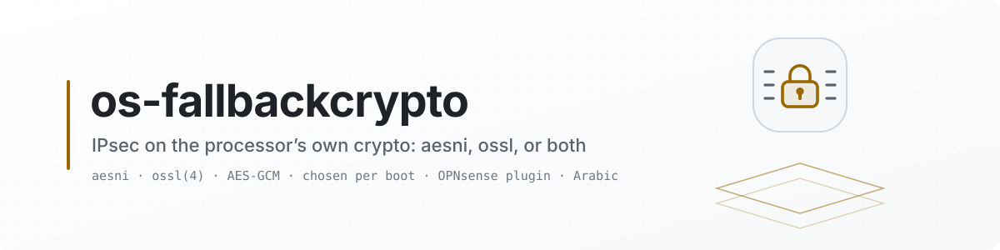

<picture>
  <source media="(prefers-color-scheme: dark)" srcset="docs/images/readme/banner-dark.svg">
  <source media="(prefers-color-scheme: light)" srcset="docs/images/readme/banner-light.svg">
  
</picture>

<p align="center">
  <a href="https://github.com/AbdelmonemAwad/os-fallbackcrypto/releases/latest"></a>
  <a href="https://github.com/AbdelmonemAwad/os-fallbackcrypto/actions/workflows/checks.yml"></a>
  <a href="LICENSE"></a>
  <a href="#what-is-tested"></a>
  <a href="https://github.com/AbdelmonemAwad/opnsense-arabic"></a>
  <a href="https://github.com/AbdelmonemAwad/os-xgs-npu"></a>
  <br>
  <a href="#what-is-tested"></a>
  <a href="#what-is-tested"></a>
  <a href="#what-is-tested"></a>
  <a href="#what-is-tested"></a>
</p>

# Fallback Crypto for OPNsense

IPsec encryption accelerated on the host's processor, for the tunnels a Sophos XGS's coprocessor does not take.

> ~~**Planned - nothing here runs yet.** This repository was opened on 2026-10-22 to hold
> Fallback Crypto as a plugin of its own. No code has been written or moved into it, and there is no
> release.~~
>
> ~~**Written, not released (2026-10-22): the first part.** The choice of the kernel's crypto provider
> for IPsec. There is no release, it has not been installed on an appliance, and nothing has been
> measured through a tunnel yet. What was run is listed under [What is tested](#what-is-tested).~~
>
> **1.0.1 (2026-10-30):** "ossl only" refused where ossl has no AES-GCM, the page's state read from what runs, a removal that takes the plugin's own loader line, and SAs behind NAT counted. Tested in qemu on OPNsense 26.7.7 before the release; see
> [What is tested](#what-is-tested).
>
> **1.0.0, the first release (2026-10-25): the first part**, the choice of the kernel's crypto
> provider for IPsec. Installed and its page opened on an XGS 3300 (OPNsense 26.7.7) before the
> release; ~~no provider has been applied through it and nothing measured through a tunnel yet~~ -
> since, on 2026-10-29 in qemu, each mode was applied through it and traffic measured through ESP
> associations, and through an IPsec tunnel, on each provider (see [What is tested](#what-is-tested)).
> Updated from XGS: Updates when os-xgs-npu is installed, or by its own self-update - see
> [Updates](#updates).

<p align="center"><b>Contents:</b> <a href="#what-it-does">What it does</a> &middot; <a href="#beside-os-xgs-npu">Beside os-xgs-npu</a> &middot; <a href="#what-is-tested">What is tested</a> &middot; <a href="#installation">Installation</a> &middot; <a href="#updates">Updates</a> &middot; <a href="#where-it-fits">Where it fits</a> &middot; <a href="#licence">Licence</a></p>

## What it does

**VPN: IPsec: Fallback Crypto** (XGS: Fallback Crypto when os-xgs-npu is installed) chooses which
of the kernel's crypto drivers encrypts the IPsec tunnels the host carries itself:

- **aesni only** - what OPNsense ships: `aesni(4)` is built into its kernel;
- **ossl beside aesni** - `ossl(4)`, the kernel's OpenSSL-based driver, loaded now and early in every
  boot, before any tunnel exists. The kernel gives a new session to the provider with the best probe
  value, and both answer "accelerated software", so on the tie it takes the one with fewer sessions:
  new SAs are shared between the two (`crypto_select_driver()`, opnsense/src stable/26.7);
- **ossl only** - the same, and `aesni` switched off at the loader (`hint.aesni.0.disabled=1`,
  written through OPNsense's own Tunables, so it is visible in System: Settings: Tunables), so from
  the next boot every session is ossl's.

**ossl only** is refused where ossl has no AES-GCM (since 2026-10-29): a processor without AES-NI, or
with it but without AVX, PCLMULQDQ and MOVBE (or VAES with AVX-512) - an Atom or a Celeron of the
kind many firewalls have. There ossl takes no AES-GCM session at all (`ossl_x86.c`), and with aesni
switched off every one, IPsec's usual cipher, would go to the kernel's plain software. The setting
is refused when it is saved and again when it is applied, and the processor card warns. A processor
whose features `/var/run/dmesg.boot` does not name is not judged.

**ossl only** switches aesni off for every user of the kernel's crypto, not for IPsec alone. ossl
takes AES-CBC, AES-GCM and ChaCha20, alone or with Poly1305, and no other cipher - read in `ossl.c`
(`ossl_lookup_cipher()`, `ossl_probesession()`, opnsense/src stable/26.7), not measured - so with
aesni off, AES-XTS (GELI's disk encryption), AES-CCM and AES-ICM (AES-CTR) go to the kernel's plain
software. The other way round, ossl takes ChaCha20-Poly1305 and aesni does not, so with ossl loaded,
beside aesni or alone, an SA with that cipher goes to ossl rather than to the plain software - read
the same way, not measured.

The page shows the host's processor and the features AES-GCM depends on, which AES-GCM code ossl
takes there, the providers present, whether IPsec is held to software providers, and the SAs in the
kernel with their algorithms.

**Why ossl.** It carries OpenSSL's own AES-GCM: with AVX-512 and VAES the wide code, and with AVX,
PCLMULQDQ and MOVBE the stitched AES-NI/GHASH code (`ossl_x86.c`), which processes several blocks at
once. The XGS 3300's host, an AMD Ryzen Embedded V1780B, has AVX, PCLMULQDQ and MOVBE and no AVX-512,
so ossl would take the second.

~~a faster software path for the IPsec associations left to the host~~ - written as the choice of
provider above; ~~whether ossl is faster than aesni on these hosts, and by how much, is not measured
yet~~ measured in qemu on 2026-10-29 (see [What is tested](#what-is-tested)): ossl's AES-GCM encrypt
took about a quarter less time a request than aesni's, and with 9000-byte frames, where the crypto
set the limit, ossl carried about a fifth more through ESP with four streams, about as much with
one. Not yet on an XGS host.
No new crypto driver was needed for this step: OpenSSL's code is already in the kernel as ossl.

~~a page, in the XGS section of OPNsense's menu or as a plugin of its own - not decided yet~~ - a
plugin of its own, under **VPN: IPsec** (under **XGS** when os-xgs-npu is installed): it is not for
XGS appliances only.

## Beside os-xgs-npu

On the XGS 136, os-xgs-npu holds IPsec's sessions to software providers
(`net.inet.ipsec.crypto_support`, its issue 399: the host's AMD ccp(4) failed every AES-GCM
operation). ossl is a software provider, so the two agree; this plugin's early hook (05) runs before
os-xgs-npu's (07). On any XGS the coprocessor encrypts the SAs it has taken whatever is chosen here;
this changes only the ones left to the host.

## What is tested

On the second XGS 3300, 2026-10-22, from a copy in `/tmp`, nothing installed and nothing loaded:

- every PHP file passes `php -l`; both Volt templates compile; the early hook passes `sh -n`;
- `status.py`: AMD Ryzen Embedded V1780B, AES-NI, PCLMULQDQ, AVX, MOVBE, AVX2 and SHA present, no
  AVX-512 or VAES, so ossl's AES-GCM would be the AVX path; `/boot/kernel/ossl.ko` present and not
  loaded; aesni the only provider; two SAs in the kernel, both `aes-gcm-16`.

On the first XGS 3300, 2026-10-25, OPNsense 26.7.7 with os-xgs-npu installed, before the release:

- installed by `install/install.sh`: rc 0, its PHP passing `php -l` in the installer;
- the page opened in the browser, its summary cards reading the status;
- its menu place: under **XGS** with os-xgs-npu installed; in its own section, **VPN: IPsec**, when
  os-xgs-npu's menu file was set aside, and back under XGS when it was put back (`place-menu.sh`).

On a plain OPNsense 26.7 in qemu, 2026-10-29: the nano image with nothing of os-xgs-npu on it, on
an Intel Xeon Gold 6252 host. Each mode was set through the plugin's model and applied with
`configctl fallbackcrypto apply`, as the page applies it.

- **The package.** `os-fallbackcrypto-1.0.0.pkg` and `SHA256SUMS` were fetched from the release and
  the sum checked OK. `pkg add` returned 0, and the page is under VPN > IPsec > Fallback Crypto.
- **The host, as the status reads it.** It found AES-NI, PCLMULQDQ, AVX, MOVBE, AVX2 and AVX-512F,
  and no VAES, so ossl's AES-GCM is the stitched AVX code ("avx"). The only provider was aesni.
- **ossl beside aesni.** apply answered `ossl loaded`, `ossl0: <OpenSSL crypto>` attached, and the
  providers became aesni and ossl. No reboot was asked for.
- **ossl only.** apply answered `hint.aesni.0.disabled=1: aesni is switched off at the next boot`
  and `loader.conf written`, and asked for a reboot; the tunable is in System: Settings: Tunables.
  After the reboot `kenv` showed the hint, no aesni device was left (`devinfo`), the early script
  had loaded ossl, and ossl was the only provider.
- **Back to off.** apply answered that ossl stays until the next boot, which does not load it, and
  `hint.aesni.0.disabled removed`. After the reboot the hint was gone, aesni was back, ossl was not
  loaded, and aesni was the only provider again.

On two such machines in qemu, 2026-10-29, the second a copy of the first, joined by a cable of
their own (a virtio NIC each, on a Linux bridge of the host). Two ESP associations were keyed by
hand with `setkey`, AES-GCM with a 256-bit key in transport mode, one each way: not a tunnel set up
by OPNsense's IPsec, but the same kind of SA in the kernel, so the same choice of provider. Both
machines were in the same mode. On the sending machine, dtrace counted the requests each provider
took (`aesni_process`, `ossl_process`) and timed one request in each provider's AES-GCM routine
(`aesni_cipher_crypt`, `ossl_aes_gcm`). iperf3 sent four streams for 15 s; the figure is the
receiver's.

| Mode | Requests taken by | Mbit/s | Encrypt, ns a request | Decrypt, ns a request |
|---|---|---|---|---|
| no ESP | - | 1312 | - | - |
| aesni only | aesni, 3.6 to 3.8 million in 15 s | 1270 to 1376, six runs | 2610 to 2798 | 1742 to 1787 |
| ossl beside aesni | aesni the outgoing SA, ossl the incoming one | 1370 | 2527 (aesni) | 1595 (ossl) |
| ossl only | ossl, 3.9 to 4.0 million in 15 s | 1397 to 1442, three runs | 1960 to 2069 | 1618 to 1700 |

- **Traffic through ESP on ossl.** With ossl only, every request went to ossl - aesni was not
  attached - and the ESP counters grew by about 2.5 million packets each way in each run.
- **Beside aesni, shared.** The two new SAs went one to each provider, as the kernel's tie rule has
  it.
- **No provider was the limit here.** Without ESP the two machines passed 1312 Mbit/s, and with ESP
  on either provider about as much: the limit was the virtual machines' own packet path. What did
  differ is the time one request took: ossl's encrypt about a quarter less than aesni's - the
  stitched AVX code - and its decrypt a little less. The encrypted requests are full-size data
  packets; the decrypted ones, on the sending machine, mostly acknowledgements, which is why they
  cost less. dtrace's own cost is in every figure, the same probes for both.

Then a tunnel set up by OPNsense's own IPsec, on the same two machines: IKEv2 with a pre-shared key,
one child in tunnel mode between the two addresses with ESP AES-GCM-256. It was saved through VPN:
IPsec's models and applied as its pages do - the Connections page's Enable, then its Apply
(interface registration, filter reload, template reload, `ipsec start`) - with a rule passing what
comes out of the tunnel on the IPsec interface. strongSwan established it, and its child SA was
installed as `ESP:AES_GCM_16-256`.

| Mode | Requests taken by | Mbit/s | Encrypt, ns a request | Decrypt, ns a request |
|---|---|---|---|---|
| aesni only | aesni, 3.7 million in 15 s | 1307, one run | 2711 | 1966 |
| ossl only | ossl, 3.6 to 3.8 million in 15 s | 1275 to 1321, three runs | 2100 to 2144 | 1700 to 1781 |

- **A tunnel on ossl, from the boot.** Set to ossl only and both machines rebooted, the tunnel came
  up again by itself: the early script had loaded ossl (`ossl0` attached) eight seconds before
  strongSwan started, no aesni device was left, and every request of the tunnel went to ossl. Its
  child SA counted about 7 million packets each way over the three runs.

Then 9000-byte frames on the two machines' cable - the MTU of both interfaces set as their pages
set it, and the host's bridge raised to match - with the ESP associations keyed by hand as above. A
frame carries six times the bytes of a 1500-byte one, so the path's work per packet weighs less and
the crypto's work per byte more. One stream, then four, 15 s each, the receiver's figure, two runs:

| | 1 stream, Mbit/s | 4 streams, Mbit/s |
|---|---|---|
| no ESP | 4877, 5008 | 5963, 6816 |
| ESP, aesni only | 3619, 3740 | 3846, 3957 |
| ESP, ossl only | 3672, 4030 | 4636, 4749 |

- **Here the crypto was the limit.** With ESP the throughput fell well below the path's own, and the
  provider counted with dtrace took every request: 1.5 to 2.0 million in 15 s.
- **ossl carried more.** With four streams, about a fifth more than aesni; with one, about the same.

Not tested: ~~`apply.php` (it loads ossl and writes the tunable)~~, ~~a tunnel on ossl, the
throughput of either provider~~ (through ESP associations keyed by hand, on 2026-10-29 in qemu,
above), ~~aesni switched off~~, ~~the page in a browser~~ (opened on 2026-10-25, above), ~~the
package (built by `tools/make-package.sh`, added with pkg), and an install on a plain OPNsense,
without os-xgs-npu~~ (on 2026-10-29 in qemu, above). ~~A tunnel and its throughput need a peer,
which a single machine in qemu does not have.~~ A second machine was added. Still not: ~~a tunnel set
up by OPNsense's IPsec (IKE) on ossl~~ (on 2026-10-29 in qemu, above), ~~and the throughput where a
provider, not the path, is the limit~~ (with 9000-byte frames, on 2026-10-29 in qemu, above).

Written on 2026-10-29 and not yet run on an OPNsense: "ossl only" refused where ossl has no AES-GCM,
on the page and by apply; a failed kldload failing the apply; the reboot and the Next boot card's
three states read from kenv and ossl; an SA behind NAT listed with its own algorithms; apply's
steps put into words by the page; the removal taking the plugin's own Tunables row with it, and an
install applying the saved setting again.

## Installation

It is not in the OPNsense plugin repository, so there is no `pkg install os-fallbackcrypto`.

**From a checkout** of this repository, on the firewall, as root:

```sh
sh install/install.sh
```

It copies `src/` onto `/usr/local` (the early boot hook with it), checks the PHP with `php -l` and
the Python with `py_compile`, puts the page in the menu (`place-menu.sh`: XGS with os-xgs-npu,
VPN: IPsec without) and records the commit for the self-update. Safe to run again: the settings in
config.xml are kept. Nothing changes until a provider is chosen and applied~~. Before
`sh install/uninstall.sh`, set it back to "aesni only" and apply, or remove `hint.aesni.0.disabled`
from System: Settings: Tunables afterwards.~~ - or, where config.xml holds "ossl beside aesni" or
"ossl only" from an earlier install, until the installer applies it again at its end (since
2026-10-29). `sh install/uninstall.sh` takes the `hint.aesni.0.disabled` row the "only" setting
wrote with the files and writes loader.conf again, so aesni is back at the next boot; a row of that
name written by hand stays, and it says so. The settings stay in config.xml.

**From a release's package.** A release carries `os-fallbackcrypto-<version>.pkg` and `SHA256SUMS`,
built by `tools/make-package.sh` in the release workflow; ~~installing it has not been tested yet~~ -
added with pkg on a plain OPNsense 26.7 in qemu on 2026-10-29 (see [What is tested](#what-is-tested)).
Check it and read it before adding it, as root:

```sh
sha256sum -c SHA256SUMS
pkg info -lF os-fallbackcrypto-*.pkg       # every file it will write
pkg add os-fallbackcrypto-*.pkg
```

`pkg delete os-fallbackcrypto` leaves ossl loaded until the next boot, which no longer loads it, and
keeps the settings~~ and a `hint.aesni.0.disabled` row in Tunables if one was written - it says so
when it does~~; the `hint.aesni.0.disabled` row the "only" setting wrote goes with it, as with
`uninstall.sh`, and one written by hand stays, with a note (since 2026-10-29). Adding the package
again, or over itself with `pkg add -f`, applies a saved "ossl beside aesni" or "ossl only" again.
The same package is built on the firewall from a checkout with `sh tools/make-package.sh -o /tmp`.

## Updates

Taken by hand, to this repository's **releases**: from **XGS: Updates**, its *Plugins* tab, where an
[os-xgs-npu](https://github.com/AbdelmonemAwad/os-xgs-npu) that lists this plugin is installed - the
tab calls `/usr/local/opnsense/scripts/fallbackcrypto/self-update.py`, with `check` to ask and
without it to install - or by running that script. No cron entry runs it. It asks GitHub for the
latest release and, when that is ahead of what is installed, downloads it and runs the
`install/install.sh` it carries - the same script a hand install runs. A change merged on `main`
reaches an installed firewall when it is released, not before.

- **Only forward.** What is installed is recorded in `/usr/local/share/os-fallbackcrypto/installed.json`
  by the installer: the commit, from a git checkout or from the `.source-commit` stamp an update
  leaves in the tree. A firewall running something newer than the release is not taken back; an
  install with no commit recorded takes the latest release once.
- **A package install records no commit**, so its first self-update takes the latest release and
  installs it with `install/install.sh`, outside pkg. A package is updated with a newer package
  instead: `pkg add -f`.
- **What happened** is in the system log as `self-update`, in
  `/usr/local/share/os-fallbackcrypto/update.json`, and the installer's output in `update.log`
  beside it.
- `self-update.py check` says what it would do and changes nothing.

~~Not tested yet: an update taken this way - 1.0.0 is the first release, so none has been ahead of
an installed copy.~~ Tested on 2026-10-29 on a plain OPNsense 26.7 in qemu, where the package had
been added with pkg, which records no commit: `self-update.py check` found the release `v1.0.0`
(2dcbb8c9a820) and nothing installed to compare it with, so to be taken. `self-update.py` fetched
its source, ran its `install/install.sh` and answered `updated to v1.0.0 (2dcbb8c9a820)`, which the
system log has too. `installed.json` then recorded that commit, from the stamp, and a second check
found it identical: nothing to take. ~~Not yet: a release ahead of the one installed - 1.0.0 is
still the only release.~~ Taken on 2026-10-30, on an XGS 3300 with OPNsense 26.7.7: with 1.0.0
installed, `self-update.py`, run over SSH, answered `updated to v1.0.1 (c68414407d80)`, the system
log carries the same line, and `installed.json` recorded that commit.

## Where it fits

It is one part of the [os-xgs-npu](https://github.com/AbdelmonemAwad/os-xgs-npu) project, which puts OPNsense on Sophos XGS hardware, and works the way its other plugins do: changes by pull request, a release installed from **XGS: Updates** (listed there since os-xgs-npu 0.1.0-alpha.8, and installed with the project's update since 0.1.0-alpha.8.2), its Arabic in [opnsense-arabic](https://github.com/AbdelmonemAwad/opnsense-arabic)'s catalogue.

## Licence

BSD 2-Clause - see [LICENSE](LICENSE).
